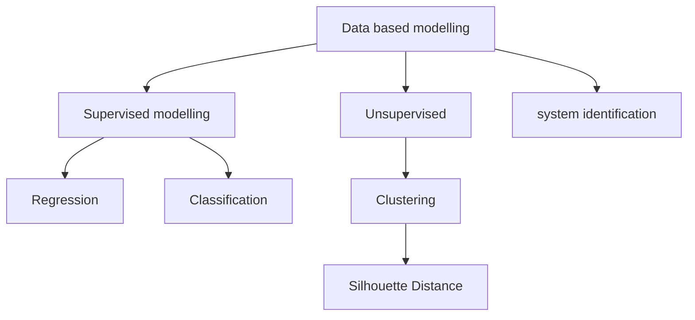

# 08/10/26 Thu 8:02am

## Data-Based Modelling
The process of developing a model of a system using measured data. The model learns relationship and pattern from the data to predict output or describe system behaviour.

| Regression | Classification      |
| ---------- | ------------------- |
| MSE        | Confusion matrix    |
| RMSE       | -> Precision recall |
| IAE        | -> Accuracy         |
| $R^{2}$    | -> F1 score         |
#### Linear Regression
$$
y=mx+c
$$
$$
m = \frac{\text{Sum of production of deviation}}{\text{Sum of square of deviation for x}}
$$
$$
c = \text{mean of y}- (m\times \text{mean of x})
$$

example:

| V (x) | $\omega$ (y) | Mean of X | Mean of Y | Deviation in X | Deviation in Y | product of deviations | deviation of $x^{2}$ |
| ----- | ------------ | --------- | --------- | -------------- | -------------- | --------------------- | -------------------- |
| 2     | 210          | 5         | 500       | -3             | -290           | 870                   | 9                    |
| 4     | 390          | 5         | 500       | -1             | -110           | 110                   | 1                    |
| 6     | 610          | 5         | 500       | 1              | 110            | 110                   | 1                    |
| 8     | 790          | 5         | 500       | 3              | 290            | 870                   | 9                    |
| ---   | ---          | ---       | ---       | ---            | ---            | 1960                  | 20                   |
now 
$$
m = \frac{\text{Sum of production of deviation}}{\text{Sum of square of deviation for x}}
$$
$$
\therefore m =\frac{1960}{20} = 98
$$
$$
c = \text{mean of y}- (m\times \text{mean of x})
$$
$$
\therefore c = 500 - (98 \times 5) = 10
$$
Now using the equation.
$$
\hat{\omega} = 98 V+10
$$

| V(X) | $\omega$ (Y) | $\hat{\omega}$ | $\omega - \hat{\omega}$ Error | Error Square |
| ---- | ------------ | -------------- | ----------------------------- | ------------ |
| 2    | 210          | 206            | 4                             | 16           |
| 4    | 390          | 402            | -12                           | 144          |
| 6    | 610          | 598            | 12                            | 16           |
| 8    | 790          | 794            | -4                            | 144          |
now Mean Squared Error is 
$$
MSE = \frac{1}{n} \sum _{i =1}^{n} \text{Error Square}
$$
