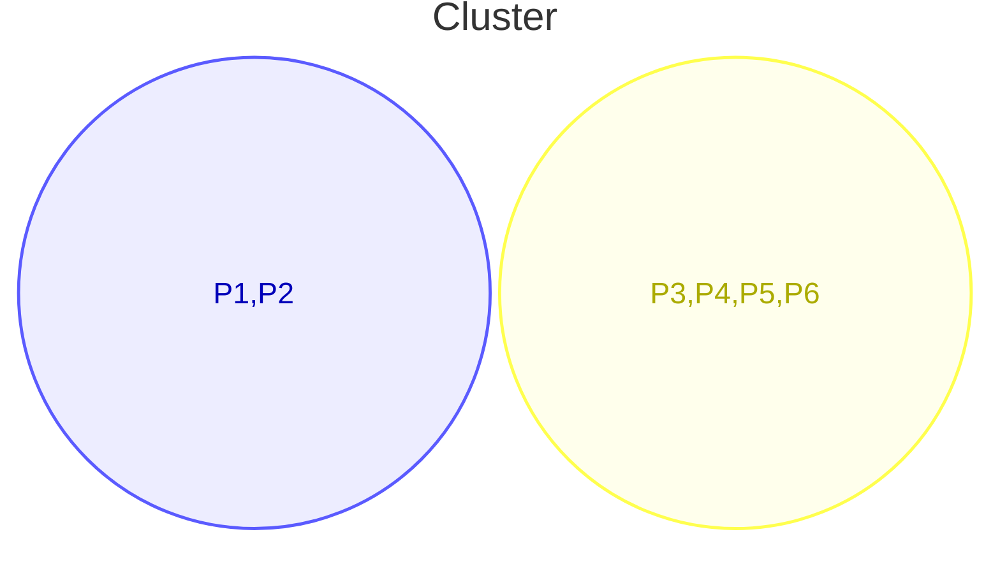

# 15/10/26 Thu 8:05am

### K- Means Clustering
Is an unsupervised learning algorithm that divides the observations into k groups based on similarity. Observations within a group are close to one another in the selected feature space.

Steps for k-means clustering algorithm.
1. Select the number of clusters $K$
2. Choose the $K$ initial centroids of the cluster
3. Calculate each observation distance from every centroid
4. Assign each observation to its nearest centroid/cluster
5. Recalculate each centroid
6. Repeat Step Three to Five until the maximum iteration count is reached

where the centroid is given by:
$$
\left(\frac{x_{1}+x_{2}+x_{3}+\dots x_{n}}{n} ,\frac{y_{1}+y_{2}+y_{3}+\dots y_{n}}{n}\right)
$$
### QnA

#### Q1 

>[!question]
>A pump generates two features without labels, the observations for the historical data are as given below
>Divide these features into two clusters with initial centroids as (1,1) and (3,1)

|     | Flow Feature | Pressure Feature |     |
| --- | ------------ | ---------------- | --- |
| P1  | 1            | 1                | ✅   |
| P2  | 1            | 3                |     |
| P3  | 3            | 1                | ✅   |
| P4  | 7            | 7                |     |
| P5  | 7            | 9                |     |
| P6  | 9            | 7                |     |

##### Soln

|          | Distance to (1,1) | Distance to (3,1) |
| -------- | ----------------- | ----------------- |
| P2 (1,3) | 2                 | 2.8284            |
| P4 (7,7) | 8.4852            | 7.211             |
| P5 (7,9) | 10                | 8.9442            |
| P6 (9,7) | 10                | 8.4852            |

The new centroids are
$$
\left( \frac{1+1}{2} \right),\left( \frac{1+3}{2} \right) \implies (1,2)
$$
$$
\left( \frac{3+7+7+9}{4} \right),\left( \frac{1+7+9+7}{4} \right) \implies (6.5,6)
$$

